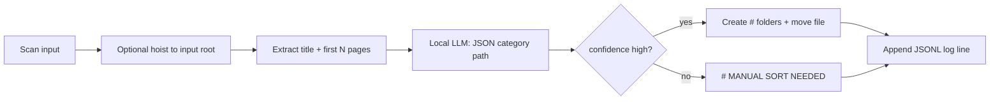

# Auto Library Manager

**Auto Library Manager** is a desktop-friendly tool (Tkinter GUI + command-line) that uses a **local** large language model to sort ebooks and documents into a folder tree shaped like `# Category` / `# Subcategory`. It reads the title and the first few pages of each book, asks your LLM for a subject path, then moves files into the matching folders—or into `# MANUAL SORT NEEDED` when the model is not confident.

There is **no bundled cloud API**. You point the app at any **OpenAI-compatible** server on your machine (LM Studio, llama.cpp server, Ollama with an OpenAI shim, etc.). Your books never leave your control except as HTTP payloads to the URL you configure.

---

## What problem it solves

Personal ebook libraries grow messy: downloads pile up in one folder, archives contain multiple books, and manual sorting does not scale. Auto Library Manager automates the boring part—**guess the subject from content** and **file it under a consistent `#` taxonomy**—while keeping humans in the loop for uncertain cases.

Typical workflow:

1. Drop new books into an **input** folder (or a staging subfolder like `# Uncategorized`).
2. Run **Smart categorize** (GUI or CLI).
3. Review `# MANUAL SORT NEEDED` and skim the activity log or JSONL audit trail.
4. Optionally run **category inventory** to spot duplicate or overlapping `#` folder names after a big run.

---

## Privacy and network behavior

| Component | Behavior |
|-----------|----------|
| **LLM** | HTTP only to the **base URL you set** (default `http://127.0.0.1:1234`). No OpenAI/Google/Anthropic endpoints are hard-coded. |
| **Book content** | Read locally from disk; text sent to the LLM is title + excerpt (first *N* pages). |
| **OCR** | Optional local **Tesseract** subprocess (`tesseract` on PATH) for scanned PDFs. |
| **Archives** | Extracted with Python `zipfile` and optional `unrar` / `7z` on PATH. |
| **GUI settings** | Saved in your home directory as `.library-manager-gui.json` (paths, LLM URL, options—no account system). |
| **Run logs** | Append-only `.library-categorize-log.jsonl` under your **output** library root (one JSON object per processed item). |

If you point the LLM URL at another machine on your LAN, traffic stays on your network—you choose the trust boundary.

---

## Supported formats

**Books:** PDF, EPUB, MOBI/AZW, DJVU, HTML, plain text, Markdown, RTF, DOCX, CBZ/CBR, FB2, XPS, and more (see `BOOK_EXTENSIONS` in `src/library_manager/categories.py`).

**Archives:** ZIP, RAR, 7Z—each contained book is extracted (under a hidden `.library-extract` workspace), categorized, then cleaned up.

**Folder bundles:** Directories that look like chapter splits (e.g. multiple PDFs meant as one work) can be moved as a unit.

---

## Folder conventions

- Category folders are named with a **`# `** prefix, e.g. `# Science`, `# Science / # Biology` on disk as nested folders `# Science/# Biology`.
- **`# MANUAL SORT NEEDED`** is created on the output root for low-confidence classifications.
- **`ai-categories.json`** on the output root records logical paths the AI has used (spelling, deduplication hints—not a rigid whitelist; the model can still propose new paths).
- Optional seed taxonomy: copy `category-guide.example.json` to your output folder and rename or merge into `ai-categories.json` if you want starter categories and descriptions.

**Input vs output:** You can scan one folder and write sorted books to another (e.g. ingest from `D:\Inbox`, file into `E:\Library`). When input and output differ, the scanner walks nested folders more aggressively so books inside existing `#` trees can still be picked up.

---

## How Smart categorize works (pipeline)

High-level flow for each book (or archive member):



### 1. Discovery (`scanner.py`)

- Walks the input tree for book files, archives, and chapter bundles.
- Can restrict to a single relative folder (GUI: **Only from folder**).
- Skips `# MANUAL SORT NEEDED` unless **Include # MANUAL SORT NEEDED** is checked.
- Ignores internal extract dirs (`.library-extract`, `_nested_*`).

### 2. Optional flatten (`mover.py`)

If **Pull books from nested subfolders** is enabled, eligible files are hoisted to the input root before classification (behavior depends on whether input equals output).

### 3. Text extraction (`text_extract.py`, `archive_extract.py`)

- Pulls metadata title when available, else filename.
- Reads up to *N* pages from the text layer (PyMuPDF for PDF, ebooklib/BS4 for EPUB, etc.).
- If the PDF has little text and OCR is enabled, runs Tesseract on rendered page images.

### 4. Catalog context (`open_catalog.py`, `taxonomy.py`)

- Loads existing `#` folder paths from the **output** root.
- Merges `ai-categories.json` for known logical paths and descriptions.
- Builds a shortened list of “existing library paths” for the prompt (with title-based shortlisting when the list is long).

### 5. LLM call (`llm.py`, `prompts_open.py`)

- Single **chat completion** per book: system prompt + user block with title, path, optional content excerpt, and existing paths.
- Model returns JSON: `category` (logical path like `Science/Botany`), `confidence` (`high` / `low` / `none`), `reason`, optional `description` for new leaves.
- Temperature is low (0.05) for stable filing.

### 6. Acceptance and move (`categorize.py`, `categories.py`)

- Only **`confidence: high`** with a valid path triggers an automatic move.
- New paths can create new `#` folders on disk and append to `ai-categories.json` when **Save new AI paths** is enabled.
- Otherwise the file goes to **`# MANUAL SORT NEEDED`** with the reason preserved in logs.

### 7. Concurrency (`categorize_runner.py`)

- Multiple books are processed in parallel up to **LLM concurrency** (default 4, max 16), bounded by a semaphore inside `LocalLLMClient` so your local server is not overwhelmed.

---

## Requirements

- **Python 3.10+**
- A running **OpenAI-compatible** local inference server (default port **1234** is common for LM Studio).
- **Windows, macOS, or Linux** (GUI uses Tkinter, included with most Python builds).
- For scanned PDFs: [Tesseract OCR](https://github.com/tesseract-ocr/tesseract) on PATH.
- For RAR/7z archives: `unrar` or `7z` on PATH (ZIP works out of the box).

---

## Installation

Clone or copy this repository, then:

```powershell
cd path\to\auto-library-manager
python -m venv .venv
.\.venv\Scripts\Activate.ps1   # macOS/Linux: source .venv/bin/activate
pip install -e .
```

Start your local model server, then launch the GUI:

```powershell
.\launch-gui.ps1
# or, after pip install -e .
library-sort-gui
```

On Linux, if Tkinter is missing, install the `python3-tk` package for your distribution.

---

## GUI guide

| Control | Purpose |
|---------|---------|
| **Input folder** | Where to find books to classify. |
| **Output folder** | Where `#` category trees and sorted files go (empty = same as input). |
| **Pull books from nested subfolders** | Hoist eligible files to input root before sorting. |
| **URL / Model** | LLM base URL; model ID optional (auto-detected from `/v1/models` if blank). |
| **LLM concurrency** | Parallel requests (1–16). |
| **Only from folder** | Limit scan to one relative path (e.g. `# Uncategorized`). |
| **First pages to read** | How many pages feed the model (1–30). |
| **Limit** | Process only the first *N* items (0 = all). |
| **Dry run** | Log decisions without moving files. |
| **Include # MANUAL SORT NEEDED** | Re-process the manual queue. |
| **Save new AI paths** | Update `ai-categories.json` on the output root. |
| **OCR scanned PDFs** | Use Tesseract when the text layer is empty. |

Use **Dry run** with a small **Limit** first. **Stop** sets a cancel flag; the worker finishes the current item and exits.

Settings persist to `~/.library-manager-gui.json` when you start a job.

---

## CLI reference

Entry points (after `pip install -e .`):

| Command | Role |
|---------|------|
| `library-sort-gui` | Tkinter GUI |
| `library-sort` | Batch categorize |
| `library-category-inventory` | Post-run folder report |

### Categorize examples

```powershell
# Preview five books without moving
library-sort "D:\Ebooks\Inbox" --dry-run --limit 5

# Separate input and output libraries
library-sort "D:\Inbox" --output "E:\Library"

# Only a staging folder
library-sort "D:\Library" --from-folder "# Uncategorized"

# Re-run manual queue
library-sort "D:\Library" --from-folder "# MANUAL SORT NEEDED" --include-manual
```

Logs default to `<output-root>/.library-categorize-log.jsonl`. Override with `--log`.

Run `library-sort --help` for all flags (pages, concurrency, LLM URL, OCR, registry path, etc.).

### Category inventory

After a large run, generate a text report of every `#` folder (counts, tree, duplicate-name warnings):

```powershell
library-category-inventory "E:\Library" -o "E:\Library\category-inventory.txt"
# or
.\write-category-inventory.ps1 "E:\Library"
```

---

## Project layout

```
Git/
├── README.md                 # This file
├── LICENSE                   # MIT
├── pyproject.toml            # Package metadata and dependencies
├── gui.py                    # Dev launcher (adds ./src to PYTHONPATH)
├── launch-gui.ps1            # Windows-friendly GUI launcher
├── write-category-inventory.ps1
├── category-guide.example.json
└── src/library_manager/
    ├── gui.py                # Tkinter application
    ├── cli.py                # argparse CLI for library-sort
    ├── categorize_runner.py  # Thread pool + job orchestration
    ├── categorize.py         # Per-book classify + move
    ├── llm.py                # OpenAI-compatible HTTP client
    ├── prompts_open.py       # System/user prompts
    ├── open_catalog.py       # ai-categories.json + disk paths
    ├── scanner.py            # File discovery
    ├── text_extract.py       # Page/sample extraction
    ├── archive_extract.py    # Zip/rar/7z handling
    ├── mover.py              # Moves and hoisting
    ├── categories.py         # # folder naming helpers
    ├── taxonomy.py           # Logical ↔ disk path mapping
    ├── category_inventory.py # Inventory report builder
    └── ...
```

---

## Tips for good results

- Use a model strong enough for short JSON classification; very small models may send more books to manual sort.
- Keep **first pages** at 5 unless books need deeper context (tradeoff: slower extraction, more tokens).
- Maintain `ai-categories.json` so the model reuses your spelling for recurring subjects.
- Run **category inventory** after merging libraries to find near-duplicate `#` folder names.
- Back up your library before the first non–dry-run on a large collection.

---

## License

MIT — see [LICENSE](LICENSE).

---

## Contributing

This folder is intended as the **public** copy of the tool: no personal library paths, machine names, or private category lists beyond the generic `category-guide.example.json`. Issues and PRs welcome on your published repository.
